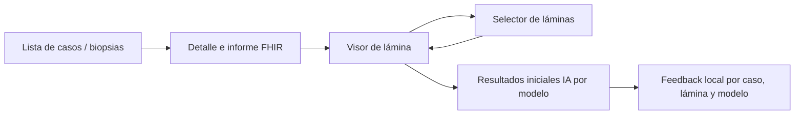

# Vistas y módulos del visualizador

## Flujo



La lista conserva los filtros por tejido y estado, búsqueda por caso, paciente,
descripción de biopsia e informe. El informe FHIR puede haber sido corregido: no
se presenta como inferencia original. Las predicciones originales se cargan por
JSON en el visor y permanecen separadas del feedback; no se escribe a FHIR.

## Identidad de caso, estudio y lámina

La lista pasa `caseId` e `imagingStudy` al visor y el selector añade `seriesUID`.
La resolución consulta los informes del caso y conserva el estudio elegido.
Las URLs con solo `caseId` abren únicamente casos con un estudio verificable.
La serie activa aporta sus instancias y endpoint, con respaldo del estudio.

## Contrato de carga de resultados

El Excel proporciona un catálogo, no predicciones, coordenadas, valores de clase,
probabilidades, rutas de archivos ni definición de esquema. Se omiten los modelos
A/B/C de ejemplo. El contrato de importación de esta POC es explícito:

```json
{
  "caseId": "ID DEL CASO ACTIVO",
  "seriesUID": "UID DE LA LÁMINA ACTIVA",
  "results": [
    { "modelId": "mitosis", "value": "SALIDA ORIGINAL DEL MODELO" }
  ]
}
```

`score` es opcional (0–1); los campos adicionales se conservan y se muestran en el
JSON detallado. Los identificadores se muestran en cada entrada del catálogo.
Los archivos se limitan a 5 MB y se validan contra el caso y la serie activos.
Las cargas viven en memoria hasta cambiar de lámina; el feedback se guarda
localmente con copia de su resultado original y se recupera al cargar ese mismo
resultado. No es persistencia clínica compartida.

Los heatmaps y candidatos se describen en el catálogo. Su representación espacial
queda pendiente hasta disponer de JSON reales y confirmar sistema de coordenadas,
referencia DICOM, resolución, clases y normalización del heatmap. Los vínculos a
Drive del Excel son ejemplos de referencia, no una integración implementada.

## Herramientas y referencias

Barra visible: desplazamiento, zoom por arrastre, acercar/alejar, ROI rectangular
y poligonal, distancia, edición y visibilidad de ROI, rotación, restauración y
exportación JSON. Se muestra escala en µm/píxel obtenida de la proyección DICOM;
el nivel de zoom no representa magnificación óptica. Las ROI exportan coordenadas
DICOM de la lámina en mm con FrameOfReferenceUID y se pierden al salir si no se
exportan. Las correcciones de ROI son independientes del resultado IA importado.

Referencias de diseño:
- OHIF: https://docs.ohif.org/user-guide/viewer/toolbar/
- ESDIP, guía de selección de sistemas: https://doi.org/10.1002/path.70103

Esta implementación toma herramientas de esas referencias; no certifica
cumplimiento ESDIP. Pendientes de validación: magnificaciones ópticas 10×/20×/40×
con metadatos del escáner, comparación simultánea, áreas, atajos y recorrido de
tejido, además del adaptador espacial para las salidas reales.

## Verificación

`node --test --test-isolation=none tests/*.test.mjs` y `npm run build`.
Prueba manual con FHIR y DICOMweb configurados: buscar y filtrar casos, abrir una
lámina, navegar, dibujar y editar ROI, medir una distancia, exportar y comprobar
coordenadas, importar un JSON del caso/serie activos, guardar feedback, recargar
y comprobar que la predicción original no cambia. Un JSON de otra lámina debe
rechazarse. Sin endpoints configurados no se ha validado este recorrido integrado.


## Importación nativa CLAM

Resultados IA conserva el formato POC y acepta un `clam_ensemble.report` más
un `clam_ensemble.maps` versión 1.0, juntos o en selecciones sucesivas. El
caso, la serie y los identificadores de estudio declarados se contrastan con
la lámina activa. Los archivos antiguos que solo identifican el `slide_id`
pueden inspeccionarse como contenido sin vincular. La revisión local se
habilita para resultados con serie verificada.

El report conserva `gated_off`, probabilidades, campos adicionales y síntesis
MLLM. Los maps muestran únicamente las capas presentes en el archivo y se
validan por ejecución, cantidad de patches, coordenadas y scores. Se informa
si los patches exceden las dimensiones DICOM. El visor requiere confirmar
el registro OpenSlide a DICOM antes de dibujar overlays.

La comprobación anterior del archivo 137092 registró patches fuera del ancho
DICOM de 33280 píxeles. El panel conserva el aviso de desborde sin recortar ni
reescalar los patches. Ante un error se ocultan los resultados, y la acción
«Volver a la carga anterior» recupera explícitamente la última carga válida.
